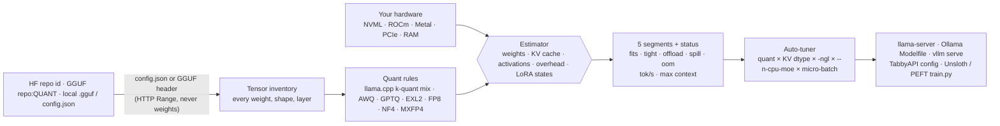

<div align="center">

<a href="#-try-it-in-10-seconds"></a>

# vram-fit — exact VRAM calculator for local LLMs

**Inference + LoRA/QLoRA fine-tuning · llama.cpp · Ollama · vLLM · ExLlamaV2 · Unsloth · NVIDIA · AMD · Apple Silicon**

[](https://github.com/GinckL/vram-fit/actions/workflows/ci.yml)
[](pyproject.toml)
[](pyproject.toml)
[](AGENT_GUIDE.md)
[](llms.txt)
[](LICENSE)

[**Try it**](#-try-it-in-10-seconds) · [**Will it fit?**](#%EF%B8%8F-will-it-fit-on-my-gpu) · [**Why OOM happens**](#-why-your-model-ooms) · [**FAQ**](#problems-solved--common-developer-questions) · [**Agent guide**](AGENT_GUIDE.md) · [**API**](#-reference)

<sub>Created by <b>Azimxon Vaxobov (<a href="https://github.com/GinckL">Ginckl</a>)</b> · <a href="https://azimxonvaxobov.netlify.app">Website</a> · <a href="https://www.linkedin.com/in/azimxon-vaxobov/">LinkedIn</a> · <a href="https://t.me/A_Vakhobov">Telegram</a></sub>

</div>

> [!TIP]
> **TL;DR** — `CUDA out of memory` happens because nobody knows how much VRAM the weights, **KV cache**, context length, batch size, flash-attention buffers and **AdamW/LoRA optimizer states** will take on *their* GPU. **vram-fit** computes it megabyte-by-megabyte **before you download a single weight file**: it reads only `config.json` or the GGUF header (KBs to a few MB), probes your NVIDIA / AMD / Apple Silicon hardware, predicts tokens/s from memory bandwidth, and prints a tuned `llama.cpp` / `Ollama` / `vLLM` / `ExLlamaV2` / `Unsloth` command that does not OOM. **Measured:** GGUF sizes within **0.02–0.16 %** of published files, KV cache identical to llama.cpp's own log, **0.26 ms per estimate**, zero dependencies.

<br>

## ⚡ Try it in 10 seconds

```bash
pip install "vram-fit @ git+https://github.com/GinckL/vram-fit"
vram-fit fit Qwen/Qwen2.5-14B-Instruct --gpu auto -c 32k
```

<p align="center">
  
</p>

<p align="center"><sub>Real, unedited output — regenerated from the engine by <code>scripts/render_readme_assets.py</code>. No GPU needed to try it: <code>--gpu rtx-4090</code>, <code>--gpu m3-max-64gb</code>, <code>--gpu "2x rtx-3090"</code> … 105 presets.</sub></p>

<br>

## 🎬 Why your model OOMs

<p align="center">
  
</p>

The weights were never the problem — **the KV cache grows with every token of context**. vram-fit sees it coming and hands you the fix (`-ctk q8_0 -ctv q8_0 -fa on`) before you hit it. Every run reports the same five segments against your GPU's ceiling:

| | Segment | What eats it | What vram-fit tunes |
|:-:|---|---|---|
|  | **Model Weights** | params × bits/weight, per tensor (Q4_K_M keeps `attn_v`/`ffn_down` partly in Q6_K) | quant, `-ngl`, `--n-cpu-moe` |
|  | **KV Cache** | context × batch × layers × KV heads × head dim × dtype | context, `-ctk/-ctv`, `--kv-cache-dtype` |
|  | **Activation Buffers** | compute graph, logits, attention scores (huge without flash attention) | `-ub`, flash attention, checkpointing |
|  | **CUDA/Driver Overhead** | CUDA/ROCm/Metal context, CUDA graphs, NCCL, your desktop | `--gpu-memory-utilization`, `--enforce-eager` |
|  | **LoRA/Optimizer States** | adapters + grads + AdamW moments (training only) | rank, 8-bit / paged optimizers, QLoRA |
|  | **VRAM ceiling** | your card (probed), or the macOS GPU wired limit | `fits` · `tight` · `offload` · `spill` · `oom` |

<br>

## 🗺️ Will it fit on my GPU?

The best config `vram-fit fit` picks for each model × GPU at **16k context** (llama.cpp, 64 GB system RAM). Click-free answers to the question everyone asks:

<!-- cheatsheet:start -->
| Model ↓ / GPU → | RTX 3060<br>12 GB | RTX 4060 Ti<br>16 GB | RTX 4090<br>24 GB | RTX 5090<br>32 GB | 2× RTX 3090<br>48 GB | Mac M4 Max<br>64 GB |
|---|:-:|:-:|:-:|:-:|:-:|:-:|
| **Llama 3.1 8B** | 🟢 **Q6_K**<br>35 tok/s | 🟢 **Q6_K**<br>28 tok/s | 🟢 **Q6_K**<br>97 tok/s | 🟢 **Q6_K**<br>167 tok/s | 🟢 **Q6_K**<br>90 tok/s | 🟢 **Q6_K**<br>56 tok/s |
| **Qwen3 14B** | 🟢 **Q4_K_M**<br>26 tok/s | 🟢 **Q6_K**<br>15 tok/s | 🟢 **Q6_K**<br>53 tok/s | 🟢 **Q6_K**<br>92 tok/s | 🟢 **Q6_K**<br>49 tok/s | 🟢 **Q6_K**<br>30 tok/s |
| **Qwen3 30B-A3B (MoE)** | 🟠 **IQ3_M**<br>64 tok/s<br><sub>experts in RAM</sub> | 🟢 **IQ3_M**<br>80 tok/s | 🟢 **Q5_K_M**<br>180 tok/s | 🟢 **Q6_K**<br>264 tok/s | 🟢 **Q6_K**<br>148 tok/s | 🟢 **Q6_K**<br>94 tok/s |
| **Gemma 3 27B** | 🟡 **IQ3_XXS**<br>20 tok/s | 🟢 **Q3_K_M**<br>13 tok/s | 🟢 **Q5_K_M**<br>31 tok/s | 🟢 **Q6_K**<br>48 tok/s | 🟢 **Q6_K**<br>25 tok/s | 🟢 **Q6_K**<br>16 tok/s |
| **Qwen3 32B** | 🟠 **Q4_K_M**<br>3 tok/s 🐢<br><sub>34/64 layers on GPU</sub> | 🟡 **IQ3_M**<br>12 tok/s | 🟢 **Q4_K_M**<br>32 tok/s | 🟢 **Q6_K**<br>41 tok/s | 🟢 **Q6_K**<br>22 tok/s | 🟢 **Q6_K**<br>13 tok/s |
| **Llama 3.3 70B** | 🟠 **Q5_K_M**<br>1 tok/s 🐢<br><sub>16/80 layers on GPU</sub> | 🟠 **Q6_K**<br>1 tok/s 🐢<br><sub>19/80 layers on GPU</sub> | 🟠 **Q4_K_M**<br>2 tok/s 🐢<br><sub>43/80 layers on GPU</sub> | 🟡 **IQ3_XXS**<br>39 tok/s | 🟢 **Q4_K_M**<br>14 tok/s | 🟢 **Q4_K_M**<br>8 tok/s |
<!-- cheatsheet:end -->

<sub>🟢 fits in VRAM · 🟡 over 92 % of VRAM · 🟠 some layers / experts run from system RAM · 🐢 runs, but under 5 tok/s · 🔴 won't fit · tok/s = predicted single-stream decode (±20 %). Regenerate: <code>python scripts/render_readme_assets.py</code>. Your GPU isn't here? <code>vram-fit fit &lt;model&gt; --gpu &lt;yours&gt;</code></sub>

<br>

## 🔥 Which quant should I download?

<p align="center">
  
</p>

```bash
vram-fit matrix bartowski/Qwen2.5-14B-Instruct-GGUF --gpu rtx-4070 --contexts 4k,16k,32k,128k --kv 8
```

<br>

## ✨ What makes it different

<table>
<tr>
<td width="33%" valign="top">

### 🪶 Zero downloads
Reads `config.json` (KBs) or just the GGUF header over HTTP `Range` — a 40 GB model costs a few MB. Works offline from a built-in catalog.

</td>
<td width="33%" valign="top">

### 🎯 Byte-exact
llama.cpp's k-quant mixing rules ported line-by-line; KV cache for GQA, MQA, DeepSeek MLA, sliding windows, hybrid linear layers.

</td>
<td width="33%" valign="top">

### 🖥️ Knows your hardware
NVML (no pynvml), ROCm sysfs, Apple Silicon wired limit, PCIe gen/width, RAM bandwidth — or simulate any of 105 GPUs.

</td>
</tr>
<tr>
<td valign="top">

### 🚀 Predicts speed
Decode tok/s from memory bandwidth (GPU + RAM + PCIe spill), prefill from TFLOPS, training tok/s from MFU.

</td>
<td valign="top">

### 🛠️ Writes the command
Tuned `llama-server`, Ollama `Modelfile`, `vllm serve`, TabbyAPI `config.yml`, Unsloth / PEFT `train.py` — every flag explained.

</td>
<td valign="top">

### 🤖 Agent-native
`--json` on every command, a published [JSON Schema](schema.json), Python API, REST + WebSocket server, [`llms.txt`](llms.txt).

</td>
</tr>
</table>

<br>

## 🧭 How it works



<br>

## ⚔️ Comparison Matrix

| | **vram-fit** | Generic web VRAM calculators | `accelerate estimate-memory` | GGUF header parsers (e.g. gguf-parser) | Download & trial-and-error |
|---|---|---|---|---|---|
| Time to answer | **~0.3 ms** compute + 1–3 small requests | seconds, manual entry | seconds–minutes (imports model code on meta device) | seconds | minutes–hours of downloads |
| Data downloaded | **KBs (config) – few MB (GGUF header)** | none (manual numbers) | config + model code | GGUF header | **full weights (5–400 GB)** |
| Setup | `pip install vram-fit`, no deps | browser | `transformers` + `accelerate` | separate binary | engine + weights |
| Per-tensor quant mix (Q4_K_M = Q4_K + Q6_K layers) | ✅ llama.cpp rules + exact GGUF types | ❌ single bits/weight | ❌ dtype only | ✅ from file | ✅ (after download) |
| KV cache: GQA / MQA / MLA / sliding window / hybrid | ✅ all | ⚠️ usually GQA only | ❌ | ⚠️ llama.cpp archs | ✅ (by OOM) |
| KV-cache quantization (q8_0/q4_0/fp8/Q4) | ✅ | ⚠️ some | ❌ | ✅ | ✅ |
| Activation / compute buffers, flash attention | ✅ engine-specific | ⚠️ rough % | ❌ | ✅ llama.cpp | ✅ |
| LoRA / QLoRA / full fine-tune (optimizer, grads, checkpointing) | ✅ | ⚠️ some | ⚠️ weights × 4 rule of thumb | ❌ | ✅ (by OOM) |
| Engines | llama.cpp, Ollama, vLLM, ExLlamaV2, Unsloth, HF PEFT | n/a | HF | llama.cpp | one at a time |
| Probes your actual GPU (NVML / ROCm / Metal), PCIe, RAM | ✅ | ❌ | ❌ | ❌ | ✅ |
| GPU ↔ RAM split, MoE expert offload, PCIe spill | ✅ | ❌ | ❌ | ⚠️ layer offload | ✅ |
| Tokens/s prediction | ✅ bandwidth + TFLOPS model | ⚠️ some | ❌ | ⚠️ | ✅ (measured) |
| Generates tuned launch command / Modelfile / train.py | ✅ | ❌ | ❌ | ❌ | ❌ |
| `--json` on every command + Python API + WebSocket | ✅ | ❌ | ⚠️ | ✅ JSON | ❌ |
| Peak memory to run the tool | ~23 MB RSS (measured) | browser tab | loads framework | small | full model in RAM/VRAM |

<br>

## 🎯 Accuracy

Checked by the test suite (`tests/test_core.py`, `tests/test_estimator.py`):

| Check | vram-fit | Reference | Error |
|---|---|---|---|
| Llama-3.1-8B Q4_K_M weights (from config.json only) | 4,912,898,048 B | 4,920,739,232 B GGUF file | −0.16 % (≈ tokenizer header) |
| Llama-3.1-8B Q8_0 | 8,532,934,656 B | 8,540,770,784 B | −0.09 % |
| Qwen2.5-7B Q4_K_M | 4,677,120,000 B | 4,683,073,504 B | −0.13 % |
| Qwen2.5-32B Q4_K_M | 19,845,357,568 B | 19,851,336,256 B | −0.03 % |
| Llama-3.3-70B Q4_K_M (llama.cpp 70B `attn_v` rule) | 42,512,531,456 B | ≈ 42.52 GB GGUF file | ≈ −0.02 % |
| Llama-3-8B KV cache, 8192 ctx, f16 | 1024.00 MiB | llama.cpp `KV self size = 1024.00 MiB` | 0 |
| LoRA r=16 all-linear trainable params, Llama-3-8B | 41,943,040 | PEFT `print_trainable_parameters` | 0 |
| Parameter counts (8B, 70B, 72B, Mixtral, DeepSeek-V3 671B, Qwen3-30B-A3B, gpt-oss-20b, Gemma-2-9B) | — | model cards | < 1 % |

The "≈ tokenizer header" gap is real: llama.cpp's own `ggml-vocab-llama-bpe.gguf` (the Llama-3 tokenizer header, no tensors) is 7,818,140 bytes, and the 8B gap is 7,841,184 bytes (tokenizer + tensor-info entries).

**Validated against upstream sources** (release 0.1.0): the GGUF parser reads all 19 real `ggml-vocab-*.gguf` files shipped with llama.cpp to their exact last byte (GGUF v2 and v3, up to 262k-token vocabularies; run with `VRAM_FIT_REAL_GGUF_DIR=…/llama.cpp/models pytest`); the k-quant mixing rules and `-ngl` placement are ported from llama.cpp's `llama-quant.cpp` / `llama-model.cpp`; every generated flag was checked against llama.cpp `common/arg.cpp`, vLLM 0.33 `EngineArgs`, TRL `SFTConfig`, Unsloth, PEFT, ExLlamaV2 `convert_exl2` and the `hf` CLI.

Throughput numbers are estimates calibrated on public llama-bench / vLLM single-stream results (e.g. Llama-3-8B Q4_K_M on RTX 4090 ≈ 127 tok/s predicted); expect ±20 %.

<br>

## Problems Solved & Common Developer Questions

<details open>
<summary><b>How do I calculate exact VRAM for LoRA fine-tuning before downloading a model?</b></summary>

Run `vram-fit estimate <hf-repo> --mode lora --engine unsloth -c 2048 -b 2 --rank 16 --gpu <your-gpu>`. vram-fit reads only `config.json`, builds the tensor inventory, and reports base weights, LoRA adapter weights + gradients (fp32), optimizer states (AdamW 8 B/param, 8-bit AdamW 2 B/param, Adafactor from matrix shapes), activations under your gradient-checkpointing mode, and the logits buffer. LoRA trainable params match PEFT exactly (41,943,040 for Llama-3-8B at r=16, all linear layers).
</details>

<details open>
<summary><b>How do I fix <code>CUDA out of memory</code> in llama.cpp or Ollama when I increase the context length?</b></summary>

The KV cache grows linearly with context: `2 × layers × kv_heads × head_dim × bytes × tokens`. `vram-fit fit <model> -c 32k --gpu auto` finds the combination of `-ngl`, `-ctk/-ctv q8_0` (needs `-fa on`) and quant that keeps you inside VRAM, and prints the exact `llama-server` command or Ollama `Modelfile` + `OLLAMA_KV_CACHE_TYPE` env.
</details>

<details>
<summary><b>How much VRAM do I need for QLoRA vs LoRA vs full fine-tuning?</b></summary>

`vram-fit fit <repo> --mode qlora` (or `lora`, `full`) — QLoRA stores linear layers in NF4 with double quantization (4.127 bits/weight) while embeddings/lm_head stay bf16; full fine-tuning with AdamW adds 14 bytes/param (bf16 grads + fp32 master + two fp32 moments). If the requested mode does not fit, `fit` automatically falls back to 8-bit AdamW, then LoRA, then QLoRA, then Unsloth offloaded checkpointing, then paged optimizers, and finally the longest sequence length that fits.
</details>

<details>
<summary><b>How much memory does the KV cache use? What is the KV cache formula?</b></summary>

Per token: `Σ_layers kv_heads × (head_dim_k × bytes_k + head_dim_v × bytes_v)`; MLA models (DeepSeek-V3/R1) store `(kv_lora_rank + rope_dim) × bytes` instead; sliding-window layers (Gemma 2/3, gpt-oss) are capped at the window; linear/SSM layers hold a fixed state. `vram-fit inspect <model>` prints KiB/token; e.g. Llama-3.1-8B is 128 KiB/token in f16 (exactly 1024.00 MiB at 8k, matching llama.cpp's log).
</details>

<details>
<summary><b>What <code>-ngl</code> / <code>--n-gpu-layers</code> should I use?</b></summary>

`vram-fit estimate <model> --gpu auto -c 8k` computes the maximum number of layers that fit (llama.cpp semantics: `-ngl n` puts the output head plus the last *n−1* repeating layers on the GPU, token embeddings always stay in RAM) and reports the RAM-bandwidth-bound tok/s you get with the rest on the CPU.
</details>

<details>
<summary><b>Which GGUF quant should I download for 8 GB / 12 GB / 16 GB / 24 GB of VRAM?</b></summary>

`vram-fit matrix <gguf-repo> --gpu <preset>` reads the real file list of the repo and shows every quant × context cell as fits / tight / offload / spill / oom with decode tok/s; `vram-fit fit` picks the best quality that fits fully, penalising configs above 92 % of VRAM. See the [cheat sheet](#%EF%B8%8F-will-it-fit-on-my-gpu) above.
</details>

<details>
<summary><b>Will this model run on my RTX 3060 / 4090 / Apple M3 Max / Strix Halo?</b></summary>

`vram-fit estimate <model> --gpu auto` probes the local GPU (NVML / ROCm sysfs / macOS sysctl) — or simulate any of 100+ presets with `--gpu rtx-3060-laptop-6gb`, `--gpu h100`, `--gpu m3-max-64gb`, `--gpu "2x rtx-3090"`, `--gpu custom:20:700`. On Apple Silicon the ceiling is the GPU wired limit (2/3 of RAM ≤ 36 GB, 3/4 above) and vram-fit prints the `sudo sysctl iogpu.wired_limit_mb=…` value you need.
</details>

<details>
<summary><b>How do I estimate tokens per second for a local LLM before running it?</b></summary>

Decode is memory-bandwidth bound: vram-fit divides the bytes read per token (active weights on GPU + KV cache at the current position, plus RAM-resident layers at RAM bandwidth, plus PCIe spill) by calibrated bandwidth efficiencies; prefill uses TFLOPS. For Llama-3.1-8B Q4_K_M on an RTX 4090 it predicts ~127 tok/s decode.
</details>

<details>
<summary><b>Does KV cache quantization (q8_0, q4_0, fp8) save memory, and how much?</b></summary>

q8_0 stores 34 bytes per 32 values (−47 %), q4_0 18 bytes per 32 (−72 %), vLLM fp8 1 byte (−50 %), ExLlamaV2 Q4 ≈ −72 %. `vram-fit estimate … --kv 8` / `--kv 4` shows the new KV segment and warns that llama.cpp needs flash attention for a quantized V cache.
</details>

<details>
<summary><b>What <code>--max-model-len</code> and <code>--gpu-memory-utilization</code> should I use in vLLM to avoid OOM?</b></summary>

`vram-fit fit <repo> --engine vllm -c 32k --gpu auto` budgets weights, the profiled activation peak (`max_num_batched_tokens`), CUDA graphs and NCCL inside `gpu_memory_utilization × VRAM`, reports how many full-length sequences the remaining KV pool holds, and emits `vllm serve` with `--kv-cache-dtype fp8`, `--quantization fp8`, `--enforce-eager` or YaRN `--hf-overrides` when needed.
</details>

<details>
<summary><b>How do I run a big MoE model (Qwen3-30B-A3B, Mixtral, gpt-oss, DeepSeek) on a small GPU?</b></summary>

`vram-fit fit <moe-model> --gpu <8-12 GB card>` evaluates llama.cpp `--n-cpu-moe N` (experts of the first N layers in RAM, attention and shared weights on GPU) against plain layer offload and picks the faster one; e.g. Qwen3-30B-A3B Q4_K_M on an 8 GB RTX 4060 Ti → `--n-cpu-moe 32`, ~36 tok/s predicted.
</details>

<details>
<summary><b>How much VRAM do Llama 3 70B / Qwen2.5-72B / DeepSeek-V3 need at 128k context?</b></summary>

`vram-fit matrix llama3.1-70b --gpu "2x rtx-3090" --contexts 8k,32k,128k` — the built-in catalog works offline, and any Hugging Face id works online.
</details>

<details>
<summary><b>Is there a Python library or API to compute LLM VRAM requirements programmatically?</b></summary>

Yes: `from vram_fit import load_model, parse_gpu_spec, estimate, Settings` (pure stdlib), every CLI command has `--json`, and `vram-fit serve` exposes REST + WebSocket endpoints. See [AGENT_GUIDE.md](AGENT_GUIDE.md) and [schema.json](schema.json).
</details>

<br>

## 📦 Install

> [!NOTE]
> **Not on PyPI yet** — until the first release, `pip install vram-fit` fails with "No matching distribution found". Install from GitHub or a clone; after the PyPI release (see [REPO_SEO_SETUP.md](REPO_SEO_SETUP.md)) it becomes `pip install vram-fit`.

```bash
# CLI + Python API (no dependencies)
pip install "vram-fit @ git+https://github.com/GinckL/vram-fit"

# + FastAPI/uvicorn for the HTTP/WebSocket API
pip install "vram-fit[server] @ git+https://github.com/GinckL/vram-fit"

# contributors
git clone https://github.com/GinckL/vram-fit && cd vram-fit && pip install -e ".[dev]" && pytest
```

<details>
<summary><b>Windows: <code>'vram-fit' is not recognized</code></b></summary>

pip installed the script into your user `Scripts` folder, which is not on `PATH` ("Defaulting to user installation…"). Run it through Python, which always works:

```bash
python -m vram_fit fit bartowski/Qwen2.5-14B-Instruct-GGUF --gpu auto -c 16k
```

or add the folder pip printed in its "is not on PATH" warning (typically `%APPDATA%\Python\Python3XX\Scripts`) to your user `PATH` and open a new terminal.
</details>

Gated repos (Llama, Gemma) need `HF_TOKEN` (or `huggingface-cli login`); without it vram-fit falls back to its built-in architecture catalog. `HF_ENDPOINT` selects a mirror; `--offline` never touches the network.

<br>

## 🍳 Recipes

```bash
# Will Llama-3.1-8B Q4_K_M with 32k context fit on an RTX 4070? How fast?
vram-fit estimate meta-llama/Llama-3.1-8B-Instruct --gpu rtx-4070 -q Q4_K_M -c 32k --kv 8 --command

# Let vram-fit pick quant, KV dtype and GPU layers for *this* machine, and print the command
vram-fit fit bartowski/Qwen2.5-14B-Instruct-GGUF --gpu auto -c 16k

# QLoRA budget + a ready-to-run Unsloth train.py with the largest micro-batch that fits
vram-fit fit meta-llama/Llama-3.1-8B --mode qlora --engine unsloth -c 4k --gpu rtx-3060-12gb

# MoE on a small GPU: keeps attention on GPU, pushes experts to RAM (llama.cpp --n-cpu-moe)
vram-fit fit Qwen/Qwen3-30B-A3B --gpu rtx-4060-ti-8gb -c 16k

# vLLM sizing for multi-GPU
vram-fit fit deepseek-ai/DeepSeek-V3 --engine vllm --gpu "8x h200" -c 32k

# Machine-readable output for agents / CI (exit 3 if it would OOM)
vram-fit estimate Qwen/Qwen3-32B --gpu rtx-4090 -q Q4_K_M -c 32k --json --fail-on-oom
```

<br>

## 📚 Reference

<details>
<summary><b>CLI reference</b></summary>

```
vram-fit estimate MODEL   VRAM breakdown + tok/s for one configuration   [--command]
vram-fit fit MODEL        auto-tune best config that fits + launch command [--prefer balanced|speed|quality]
vram-fit matrix MODEL     quant x context fit matrix                    [--contexts 4k,32k --quants Q8_0,Q4_K_M]
vram-fit inspect MODEL    architecture, params, KV/token, GGUF files
vram-fit hw               probe GPUs, RAM, PCIe, CPU
vram-fit presets          GPU presets (--vendor nvidia|amd|apple|intel)
vram-fit quants           quantization formats (--engine ...)
vram-fit catalog          built-in offline architectures + aliases
vram-fit serve            HTTP + WebSocket API (--host 127.0.0.1 --port 7860 [--allow-local-files])
vram-fit version
```

Model/run flags (estimate, fit, matrix): `--gpu auto|cpu|<preset>|"2x <preset>"|custom:GB:GBs[:TFLOPS]`, `--vram`, `--bandwidth`, `--ram`, `--ram-bw`, `--background MiB`, `--engine llama.cpp|ollama|vllm|exllamav2|unsloth|transformers`, `--mode inference|lora|qlora|full`, `-q/--quant`, `-c/--ctx` (accepts `32k`), `-b/--batch`, `--kv 16|8|4|f16|q8_0|q4_0|fp8|Q4|Q6|Q8`, `--ngl`, `--cpu-moe`, `--no-fa`, `--ubatch`, `--swa-full`, `--gpu-util`, `--max-batched-tokens`, `--enforce-eager`, `-r/--rank`, `--targets q_proj,v_proj`, `--optim adamw|adamw_8bit|paged_adamw_8bit|adafactor|lion_8bit|…`, `--gc none|standard|unsloth`, `--dataset-tokens 50M`, `--exact`, `--offline`, `--json`, `--no-color`, `--fail-on-oom`.

Exit codes: `0` success, `2` error (bad model / GPU / quant; JSON error object with `--json`), `3` result is `spill`/`oom` and `--fail-on-oom` was given. Set `VRAM_FIT_DEBUG=1` for full tracebacks.
</details>

<details>
<summary><b>JSON output (for scripts and AI agents)</b></summary>

Every command accepts `--json` and prints one document: `{"vram_fit": "<version>", "command": "<name>", "result": {…}}` or `{"vram_fit": …, "command": …, "error": {"type": …, "message": …}}`. The `estimate` result schema is in [schema.json](schema.json); key fields:

```json
{
  "status": "fits", "fits": true,
  "gpu_total_mib": 9114.0, "budget_mib": 24576.0, "headroom_mib": 15462.0,
  "segments": [
    {"key": "weights", "label": "Model Weights", "mib": 4403.5},
    {"key": "kv_cache", "label": "KV Cache", "mib": 4096.0},
    {"key": "activations", "label": "Activation Buffers", "mib": 314.5},
    {"key": "overhead", "label": "CUDA/Driver Overhead", "mib": 300.0},
    {"key": "lora_optimizer", "label": "LoRA/Optimizer States", "mib": 0.0}
  ],
  "offload": {"cpu_weights_mib": 282.3, "cpu_kv_mib": 0.0, "layers_on_gpu": 32, "layers_total": 32, "spill_mib": 0.0},
  "performance": {"decode_tok_s": 126.9, "prefill_tok_s": 6702.0, "bottleneck": "gpu_memory_bandwidth"},
  "limits": {"max_context_full_gpu": 155392, "max_batch_full_gpu": 4}
}
```
</details>

<details>
<summary><b>Python API</b></summary>

```python
from vram_fit import Settings, build_command, estimate, load_model, optimize, parse_gpu_spec, probe

model = load_model("Qwen/Qwen2.5-14B-Instruct")       # config.json only; or "repo:Q4_K_M", "./model.gguf"
gpu = parse_gpu_spec("rtx-4070")                      # or probe().primary() for the local GPU
r = estimate(model, gpu, Settings(engine="llama.cpp", quant="Q4_K_M", context=32768, kv_cache="q8_0"))
print(r["status"], r["gpu_total_mib"], r["performance"]["decode_tok_s"], r["limits"])

best = optimize(model, gpu, Settings(context=32768))  # search quant x KV x offload
print(best["command"]["shell"])

train = estimate(model, parse_gpu_spec("rtx-4090"),
                 Settings(engine="unsloth", mode="qlora", context=4096, batch=2, lora_rank=16))
print(build_command(model, train)["files"]["train.py"])
```
</details>

<details>
<summary><b>HTTP + WebSocket API</b></summary>

`pip install "vram-fit[server]" && vram-fit serve` → `http://127.0.0.1:7860` (OpenAPI at `/docs`).

Security: on loopback (default) the server only answers `Host: localhost/127.0.0.1` (blocks DNS rebinding) and CORS is limited to local origins. With `--host 0.0.0.0` there is no authentication, so local model paths are refused unless you pass `--allow-local-files`. All request settings are validated (bad input → HTTP 400 / WebSocket `error` event).

| Method | Path | Body / query |
|---|---|---|
| GET | `/api/health`, `/api/hardware?refresh=1`, `/api/presets`, `/api/quants?engine=`, `/api/engines`, `/api/catalog`, `/api/telemetry` | — |
| GET | `/api/model?id=Qwen/Qwen3-8B&quant=&exact=` | — |
| POST | `/api/estimate` | `{"model": "...", "gpu": "rtx-4090" \| {"preset": "...", "count": 2, "vram_gib": 24}, "settings": {"ctx": 32768, "quant": "Q4_K_M", "kv": 8, "ngl": null}, "limits": true, "command": true}` |
| POST | `/api/optimize` | `{"model", "gpu", "settings", "prefer": "balanced", "lock_quant": false, "global_batch": 16}` |
| POST | `/api/command`, `/api/matrix` | `{"model", "gpu", "settings"[, "contexts", "quants"]}` |

WebSocket `/ws`: send `{"op": "estimate", "rid": 7, "model": "...", "gpu": "...", "settings": {...}}` → `{"event": "estimate", "rid": 7, "data": {...}, "ms": 0.4}`. Ops: `hello`, `load_model` (streams `progress` events), `estimate`, `optimize`, `command`, `matrix`, `hardware`, `telemetry` (`{"enabled": true, "interval_ms": 500}` streams live GPU memory / utilization / temperature / power), `ping`. `estimate` and `matrix` are coalesced (newest request wins) so slider drags never queue up.
</details>

<details>
<summary><b>How the memory is computed (formulas)</b></summary>

All values are MiB (2²⁰ bytes). `L` layers, `H` hidden, `n_h` heads, `n_kv` KV heads, `d` head dim, `I` FFN width, `V` vocab, `T` tokens.

- **Weights** — every tensor is typed with the scheme's rules: GGUF k-quants reproduce llama.cpp's `llama_tensor_get_type` (`use_more_bits` layers → Q6_K for `attn_v`/`ffn_down` in Q4_K_M/Q5_K_M, Q6_K output head, Q5_K `attn_v` on 70B-class models, Q8_0 attention for 8-expert MoE, f32 routers, divisibility fall-backs); bytes = `ceil(numel / block) × block_bytes`. AWQ/GPTQ add fp16 scales + zero points per 128-group (+ GPTQ `g_idx`), FP8/INT8 add per-channel fp32 scales, NF4 uses double quantization, EXL2 uses its bpw with a 6-bit head and embeddings in RAM, MXFP4 applies only to experts. Real GGUF headers give exact bytes; repo file sizes calibrate other quants of the same repo.
- **KV cache** — `Σ_l cells_l × n_kv,l × (d_k × b_k + d_v × b_v)`; MLA: `cells × (kv_lora_rank + d_rope) × b`; sliding layers: `cells = min(ctx·batch, window·batch + ubatch)` (llama.cpp pads to 256); linear/SSM layers: fixed recurrent state per sequence. Types: f16 2 B, q8_0 34/32 B, q4_0 18/32 B, fp8 1 B, EXL2 Q4/Q6/Q8.
- **llama.cpp compute buffer** — `ub·H·16 + max(ub·2I·4, attn, logits) + mask (+ f16 K/V dequant for quantized FA)`, with `attn = ub·cells·n_h·4` without flash attention, `ub·n_h·d·8` with it, and `logits = ub·V·4` when the output head is on the GPU.
- **vLLM** — budget = `gpu_memory_utilization × VRAM`; activation peak at `max_num_batched_tokens` (vLLM's default: 8192 on ≥ 70 GB GPUs, 2048 otherwise); CUDA graphs 0.5 GiB (0 with `--enforce-eager`), NCCL per GPU for TP; remaining budget = KV pool → max concurrency at your context.
- **Training** — activations per token per layer (bf16, FA2): `2(4H + 2q + kv + 4I) + 4n_h` bytes (MoE: `4·k·I_moe`), times `L` without checkpointing; standard checkpointing keeps `L·T·2H` plus two layers' worth; Unsloth offloads the checkpoints to RAM. Logits `T·V·12` B for HF (fp32 upcast + grad), `T·V·2` for Unsloth's fused CE. LoRA: `r·(in+out)` per targeted matrix, fp32 weights + grads + optimizer. Full FT: bf16 weights + bf16 grads + fp32 master + optimizer. 7 % allocator fragmentation.
- **Overhead** — CUDA context 300 MiB (llama.cpp) / 500 MiB (PyTorch engines), ROCm 400–600, Metal 120–300, plus VRAM already used by other processes (probed).
- **Placement** — llama.cpp `-ngl n` (`i_gpu_start = n_layer + 1 − n`): output head + last `n−1` layers (+ their KV) on GPU, token embeddings in RAM; `--n-cpu-moe N`: experts of layers `< N` in RAM.
- **Speed** — decode step = `GPU_bytes/(BW·η_gpu) + RAM_bytes/(BW_ram·0.7) + spill/(PCIe·0.8) + L·12 µs (+ TP all-reduce)`, max with compute time; MoE reads only the `k/E` active experts (expected union for batches). Prefill = `(2·P_active + 4·n_h·d·Σspan) / (TFLOPS·η)` + PCIe streaming of RAM-resident weights per ubatch.
</details>

<details>
<summary><b>Supported models, engines, quantizations, hardware</b></summary>

- **Architectures**: anything with a standard `config.json` (Llama, Mistral, Mixtral, Qwen2/2.5/3, Qwen3-MoE, Qwen3-Next hybrids, Gemma 1/2/3 incl. vision towers, Phi-3, DeepSeek-V2/V3/R1 (MLA + MoE), gpt-oss (MXFP4 + sliding window), Falcon, GPT-NeoX, StarCoder2, Jamba-style hybrids) and any GGUF file. Offline catalog: `vram-fit catalog`.
- **Engines**: llama.cpp (`llama-server`), Ollama, vLLM, ExLlamaV2 (TabbyAPI), Unsloth, Hugging Face Transformers + PEFT + TRL.
- **Quantizations**: GGUF F32/F16/BF16/Q8_0/Q6_K/Q5_K_M/Q5_K_S/Q5_1/Q5_0/Q4_K_M/Q4_K_S/Q4_1/Q4_0/IQ4_NL/IQ4_XS/Q3_K_L/Q3_K_M/Q3_K_S/IQ3_M/IQ3_S/IQ3_XS/IQ3_XXS/Q2_K/Q2_K_S/IQ2_M/IQ2_S/IQ2_XS/IQ2_XXS/IQ1_M/IQ1_S/TQ1_0/TQ2_0/MXFP4_MOE, AWQ, GPTQ 4/8-bit, FP8, INT8, NF4 (bitsandbytes), MXFP4, NVFP4, EXL2 at any bpw (2.0–8.0). KV: f16/bf16/f32/q8_0/q5_1/q5_0/q4_1/q4_0/iq4_nl, fp8 (e4m3/e5m2), ExLlamaV2 Q4/Q6/Q8.
- **Hardware presets** (`vram-fit presets`): NVIDIA laptop (RTX 3050–5090 Laptop), GeForce (GTX 1080 Ti → RTX 5090), workstation (A4000 → RTX PRO 6000 96 GB), datacenter (T4, V100, A10/A10G, L4, L40S, A100 40/80, H100 PCIe/SXM/NVL, H200, B200), DGX Spark, AMD (RX 7600 → RX 9070 XT, W7900, MI210/MI250X/MI300X/MI325X, Strix Halo), Intel Arc, Apple M1 → M5 (all Pro/Max/Ultra bins). Multi-GPU with `"Nx <preset>"`.
</details>

<details>
<summary><b>Architecture & development</b></summary>

```
src/vram_fit/
  hub.py        HF API, config.json, HTTP Range reads of GGUF / safetensors headers, disk cache, offline catalog fallback
  gguf.py       streaming GGUF v1-v3 header parser (+ writer used by tests)
  ggml.py       ggml block sizes, llama_ftype names, KV cache element sizes
  model.py      ModelSpec (GQA/MLA/MoE/SWA/hybrid) + tensor inventory from config / GGUF / safetensors
  quant.py      quantization schemes, llama.cpp mixing rules, per-tensor byte accounting
  estimator.py  weights / KV / activations / overhead / training states, GPU-RAM placement, status, tok/s, limits
  optimizer.py  search over quant x KV x -ngl x --n-cpu-moe x micro-batch; utility = fit tier, quality, speed
  commands.py   llama.cpp, Ollama Modelfile, vLLM, TabbyAPI config, Unsloth / PEFT train.py
  hardware.py   NVML (ctypes), nvidia-smi, ROCm sysfs, Apple sysctl, RAM/CPU, live telemetry
  presets.py    100+ GPU presets with bandwidth, TFLOPS, compute capability, PCIe
  catalog.py    offline config.json catalog + aliases
  render.py     terminal bar / tables      cli.py  argparse CLI      server.py  FastAPI REST + WebSocket
```

```bash
pip install -e ".[dev]"
pytest -q                                   # 91 tests: parser, quant rules, KV/activation math, hub over a local Range server, CLI JSON, REST, WebSocket, JSON schema
python scripts/render_readme_assets.py      # regenerate assets/*.svg + the README cheat sheet from the live engine (--png for the social preview)
python scripts/build_llms_full.py           # regenerate llms-full.txt (use Python 3.13; CI checks both are fresh)
```
</details>

<br>

## 👤 Author & credits

<table>
<tr>
<td width="112" align="center"><a href="https://github.com/GinckL"></a></td>
<td>

**vram-fit** is created and maintained by **Azimxon Vaxobov**, known as **Ginckl**.

[](https://azimxonvaxobov.netlify.app)
[](https://www.linkedin.com/in/azimxon-vaxobov/)
[](https://t.me/A_Vakhobov)
[](https://github.com/GinckL)

</td>
</tr>
</table>

<div align="center">

### ⭐ If vram-fit saved you a 40 GB download or an OOM, star the repo — it helps others find it.

<sub>See also [AUTHORS.md](AUTHORS.md) · Cite via [CITATION.cff](CITATION.cff) ("Cite this repository" button) · MIT © 2026 Azimxon Vaxobov (Ginckl) — see [LICENSE](LICENSE)</sub>

</div>
